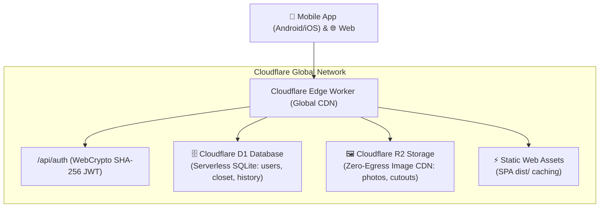

# ⚡ Firie - Complete Cloudflare Backend Architecture & Guide

This document explains how **Firie** uses Cloudflare to power:
1. **User Sign Up & Login (Edge Authentication)**
2. **Clothing Photos & Cutouts (Cloudflare R2 Object Storage - $0 Egress)**
3. **Wardrobe Items, Outfit History & User Data (Cloudflare D1 Serverless SQLite)**
4. **Fast Global Delivery (Cloudflare Workers & CDN)**

---

## 🏗️ Cloudflare Services Architecture



---

## 1. Cloudflare D1 (Database)
- **What it is**: Global, serverless SQLite running at the Cloudflare edge.
- **Why it's used for Firie**:
  - Sub-5ms database latency worldwide.
  - Zero server management, ACID transactions.
  - Generous free tier: **5 million reads/day, 100,000 writes/day, 10 GB storage**.
- **Tables configured in `schema.sql`**:
  - `users`: User accounts, emails, password hashes, and Pro subscriptions.
  - `closet_items`: Clothing pieces, categories, slots, colors, and image links.
  - `outfit_logs`: Daily worn outfits, dates, weather context, and styling history.
  - `date_plans`: Curated Addis Ababa date venue plans and bookmarks.
  - `sessions`: Token sessions and revocation.

---

## 2. Cloudflare R2 (Storage for User Photos)
- **What it is**: S3-compatible object storage with **$0 egress fees** (unlike AWS S3 which charges per gigabyte of image downloads).
- **Why it's used for Firie**:
  - Users take and upload photos of their clothing and studio camera poses.
  - Photos are uploaded directly to R2 bucket `firie-photos`.
  - Photos are delivered through the Cloudflare Worker with aggressive CDN caching (`Cache-Control: public, max-age=31536000, immutable`).

---

## 3. Cloudflare Workers (Authentication & API)
- **What it is**: V8 serverless edge functions running directly in front of the application.
- **Endpoints in `worker/index.ts`**:
  - `POST /api/auth/signup`: Registers users, hashes passwords with WebCrypto PBKDF2/SHA-256, stores in D1, and issues an HMAC-signed edge token.
  - `POST /api/auth/login`: Verifies credentials and logs user in.
  - `GET /api/auth/me`: Retrieves user profile.
  - `POST /api/upload`: Saves uploaded base64 photos to Cloudflare R2.
  - `GET /api/photo/:key`: Fast CDN serving of closet photos.
  - `GET /api/closet` & `POST /api/closet` & `DELETE /api/closet/:id`: Full wardrobe CRUD in D1.
  - `GET /api/history` & `POST /api/history`: Outfit log tracking in D1.
  - `POST /api/sync`: Automatic 1-click cloud sync of all local items and history to Cloudflare!

---

## 🚀 How to Connect Cloudflare and Make It Live

### Step 1: Login to Cloudflare via CLI
Run the following in PowerShell / terminal:
```powershell
npx wrangler login
```
A browser tab will open asking you to authorize Wrangler with your Cloudflare account. Click **Allow**.

### Step 2: One-Click Resource Provisioning
Run the automated setup script:
```powershell
.\scripts\setup-cloudflare.ps1
```
Or manually run:
```powershell
# 1. Create D1 database
npx wrangler d1 create firie-db

# 2. Apply database schema
npx wrangler d1 execute firie-db --remote --file=./schema.sql

# 3. Create R2 storage bucket
npx wrangler r2 bucket create firie-photos
```

### Step 3: Put your Database ID in `wrangler.jsonc`
When step 2 creates `firie-db`, it will print your `database_id` (e.g., `xxxxxxxx-xxxx-xxxx-xxxx-xxxxxxxxxxxx`).
Uncomment the `d1_databases` block in `wrangler.jsonc` and paste your ID:
```jsonc
  "d1_databases": [
    {
      "binding": "DB",
      "database_name": "firie-db",
      "database_id": "<YOUR-DATABASE-ID>"
    }
  ],
  "r2_buckets": [
    {
      "binding": "PHOTOS",
      "bucket_name": "firie-photos"
    }
  ]
```

### Step 4: Deploy Live!
```powershell
npm run build
npx wrangler deploy
```
Your app and backend are now instantly live at `https://firie.<your-subdomain>.workers.dev` with a global database and photo storage!
